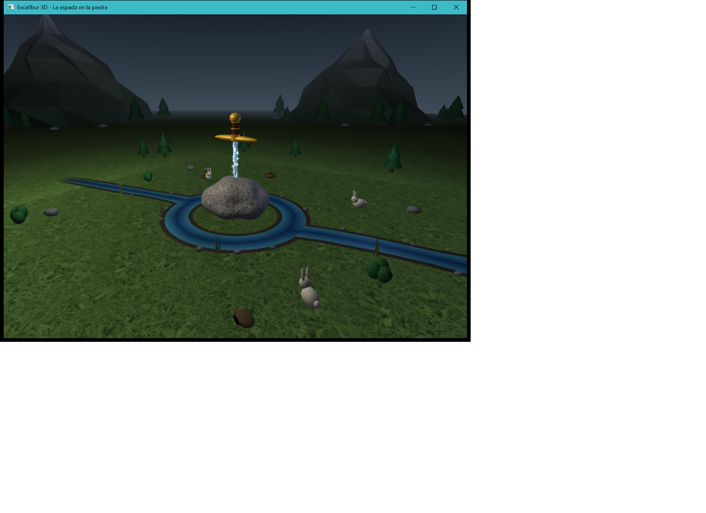
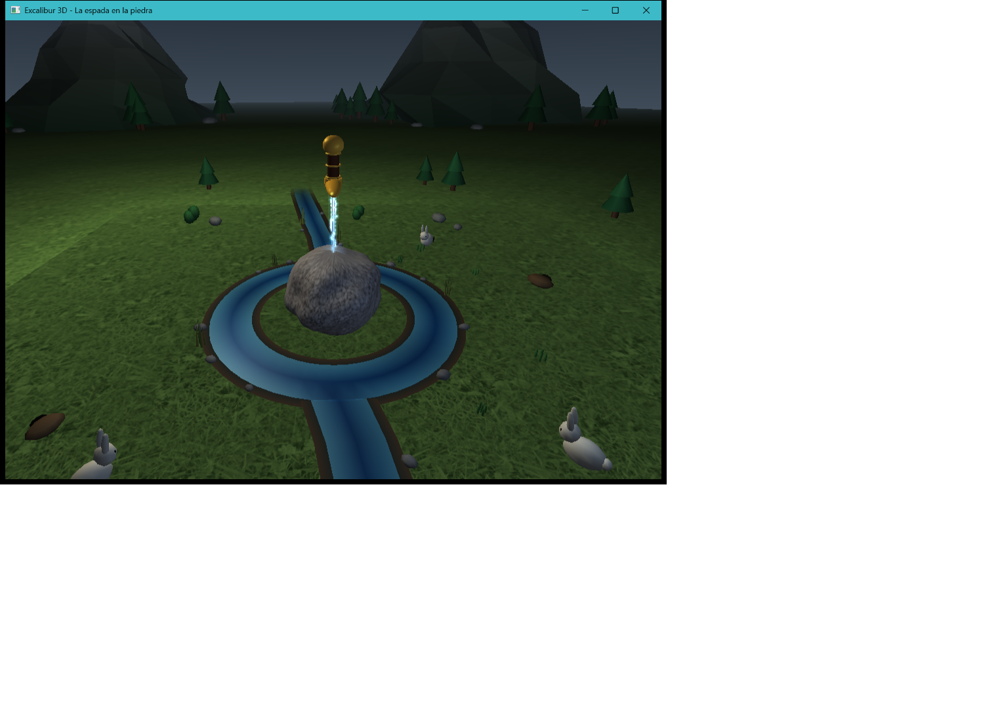
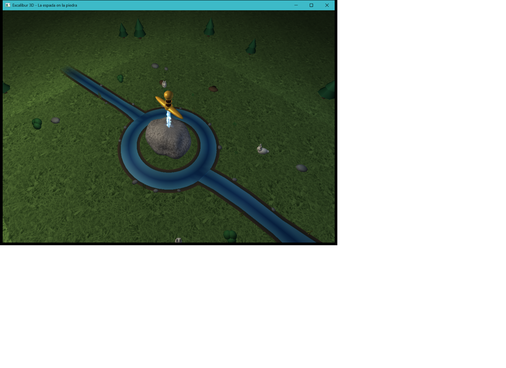
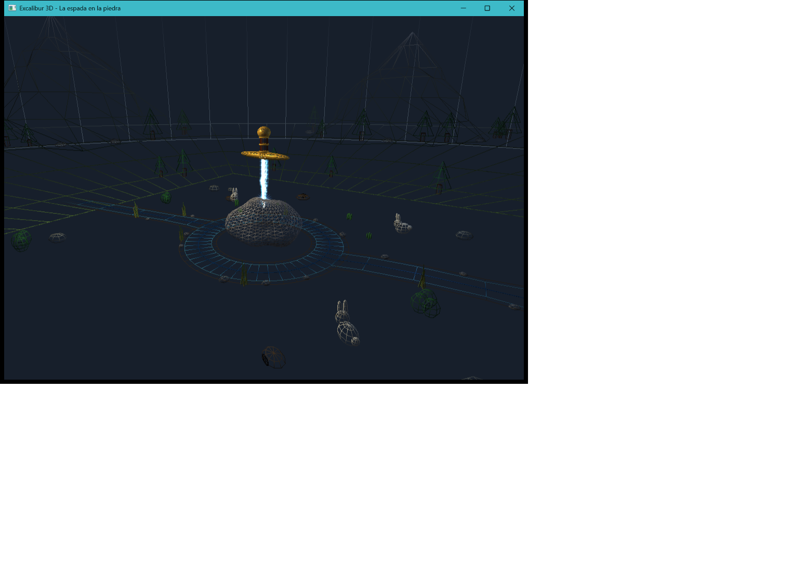

# Ambiente: paisaje lejano, horizonte y agua (rama `feature/ambiente`)

## Qué se hizo

### 1. Paisaje lejano y horizonte
Archivos nuevos: `include/excalibur/PaisajeLejano.h` y `src/objetos/PaisajeLejano.cpp`
(`excalibur::paisaje::dibujarPaisajeLejano()`).

- **Cadena de 4 montañas low-poly grandes e irregulares** (18 a 25 unidades de alto, a unas
  70 unidades del centro), hechas con una malla propia de anillos: 6 anillos de 14 vértices con radio y altura alterados por un ruido determinista, más una
  cima desplazada para romper la simetría. Las normales son por cara (aspecto facetado) y el
  winding se corrige automáticamente a CCW visto desde fuera.
- **Color por vértice según la altura**: verde bosque oscuro en la base, roca gris en el medio
  y una cima clara.
- Están colocadas **lejos, hacia -X/-Z**. Las tres cámaras están en el cuadrante +X/+Z, así
  que las montañas siempre quedan detrás de la piedra y la espada. Se dejó un hueco detrás de
  la espada para que en las vistas 1 y 3 la empuñadura se lea contra el cielo.
- La escala es grande a propósito: así la piedra y la espada se ven como el centro de un
  valle y no como una maqueta. El horizonte queda a unas 78 unidades del centro, dentro del
  plano lejano de `gluPerspective` (100).
- **Pinos** (tronco + 2 conos) y **rocas** grandes en las faldas, del lado que mira al centro.
  También hay algunos pinos pequeños cerca del suelo central, que sirven de referencia de escala.
- **Terreno extendido**: un faldón une el borde cuadrado del suelo con un círculo lejano. Usa
  la misma textura `suelo.bmp` y la misma proyección UV que el suelo de M04, por lo que la
  hierba continúa sin corte y se oscurece hacia el horizonte. Así el terreno ya no parece una
  isla cuadrada.
- **Banda de horizonte**: cilindro visto desde dentro, sin iluminación, con un degradado de
  bruma al color de `glClearColor`. No escribe en el buffer de profundidad.
- **Niebla suave `GL_FOG` (lineal, 40 → 95)** activa solo mientras se dibuja el paisaje.
  Empieza más allá del suelo central, así que la piedra, la espada y el terreno no cambian.
- Estado guardado con `glPushAttrib(CURRENT | ENABLE | FOG | LIGHTING | TEXTURE | DEPTH_BUFFER)`
  y `glPushMatrix`.

### 2. Agua y acabado del terreno
Archivos nuevos: `include/excalibur/Agua.h` y `src/objetos/Agua.cpp`
(`excalibur::agua::dibujarSistemaDeAgua()`).

- La lógica del anillo y los canales **se movió desde `Entorno.cpp`**, conservando radios,
  trazado, winding CCW y normales +Y.
- **Lecho opaco** bajo el agua con **orilla de tierra oscura** visible a ambos lados.
- **Agua semitransparente** (`GL_BLEND`, alfa entre 0.62 y 0.84) con **tonos de azul por
  vértice**: somero y claro en la orilla, profundo y oscuro en el centro. En las
  desembocaduras se iguala la profundidad para que no aparezca una franja clara.
- El agua se dibuja con `glDepthMask(GL_FALSE)` y después se restaura `GL_TRUE`. Los opacos
  (lecho, piedras, juncos) se dibujan antes.
- **Animación sutil** con `glutGet(GLUT_ELAPSED_TIME)`: el brillo varía ±6 % por vértice. Solo
  cambia el color, nunca la geometría. Los juncos se balancean ±2.5°.
- Material especular propio para el agua, restaurado por `GL_LIGHTING_BIT`.
- **Orillas**: 15 piedras pequeñas y 7 grupos de juncos (conos cerrados, sin problemas de
  culling).
- Los canales se prolongan fuera del suelo y se desvanecen con alfa hacia el horizonte.
- Estado guardado con `glPushAttrib(CURRENT | ENABLE | LIGHTING | TEXTURE | COLOR_BUFFER |
  DEPTH_BUFFER)` y `glPushMatrix`.

### Cambios en archivos existentes
- `src/objetos/Entorno.cpp`: se incluyen `Agua.h` y `PaisajeLejano.h`. Se llama a
  `paisaje::dibujarPaisajeLejano()` justo después de la escala del entorno y a
  `excalibur::agua::dibujarSistemaDeAgua()` en lugar de la función local. Se eliminaron
  `dibujarSistemaDeAgua`, `dibujarCanal`, `PuntoPlano` y el monte cónico `dibujarMonteLejano`
  porque fue reemplazado por la cadena de montañas.
- `CMakeLists.txt`: solo se añadieron `src/objetos/PaisajeLejano.cpp` y `src/objetos/Agua.cpp`.
- No se tocaron `main.cpp`, la cámara, la espada, la piedra, los controles ni ninguna firma
  existente.

## Cómo probarlo
1. Compilar y ejecutar `Excalibur3D`.
2. Teclas **1, 2, 3**: revisar que las montañas están al fondo y no tapan la espada ni la
   piedra, y que el horizonte no muestra un borde cuadrado.
3. Tecla **P**: modo alambre. Se ven la malla de las montañas, el faldón, la banda de horizonte
   y las filas del agua. No faltan caras por culling.
4. Tecla **L**: alterna la luz secundaria de M09. La niebla y el blend no afectan a los demás
   objetos.
5. Dejar la escena unos segundos: el brillo del agua y los juncos se mueven suavemente.

Compilado y probado con MSVC x64 (`/W4`, sin advertencias) y freeglut 3.0 x64.

## Capturas
| Vista 1 | Vista 2 |
|---|---|
|  |  |
| **Vista 3** | **Alambre (P), vista 1** |
|  |  |

Extra: `img/vista1_luzL.png` (vista 1 con la tecla L).

## Problema conocido
En la vista 2 se nota un ligero cambio de brillo en la unión entre el suelo de M04 y el
terreno extendido. El suelo de M04 es un único quad de 4 vértices y se ilumina por vértice
(Gouraud), mientras que el faldón tiene muchos vértices. La solución sería subdividir el suelo
de M04, pero eso queda fuera del alcance de esta rama.

## Fuentes externas
Ninguna. Toda la geometría y los colores son procedurales y están hechos en código. Solo se
reutiliza `assets/texturas/suelo.bmp`, que ya estaba en el repositorio (M05). No se agregaron
texturas nuevas.
