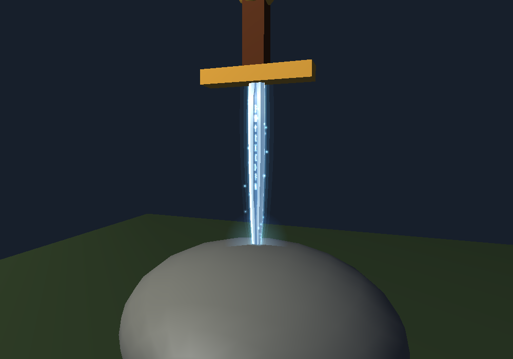
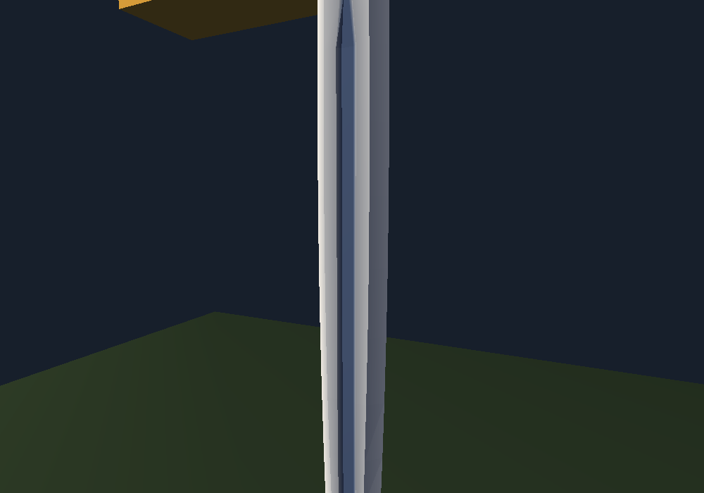
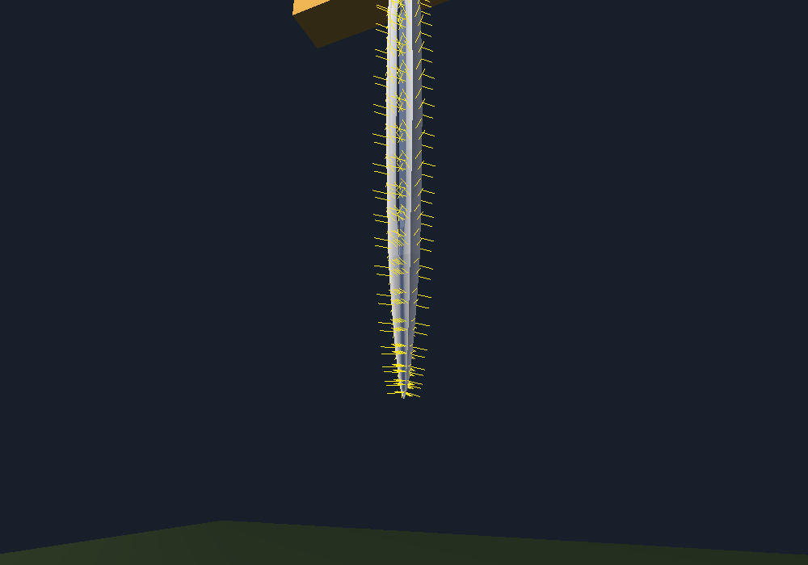
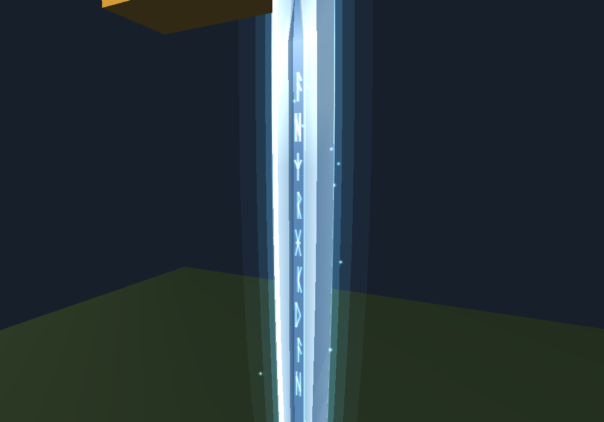
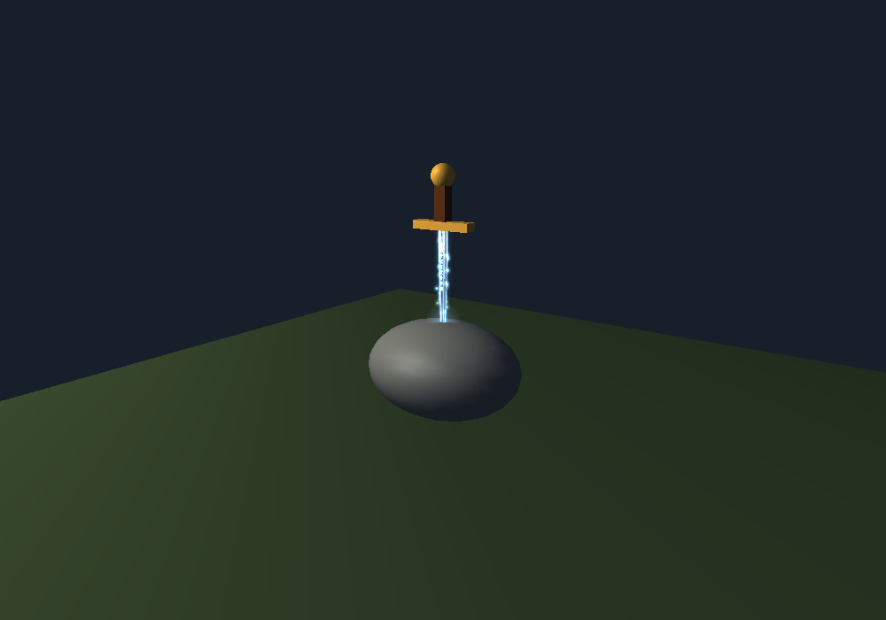

# Informe técnico · Módulo M01 · Hoja de Excalibur

**Proyecto:** Vitrina 3D «Excalibur, la espada en la piedra» · ISW-412 Computación Gráfica II
**Módulo:** M01 · Hoja de la espada (Grupo 1 · Espada)
**Integrante responsable:** _[nombre y matrícula]_
**Rama:** `feature/m01-espada-hoja` · **Archivo:** `src/objetos/EspadaHoja.cpp`
**Fecha:** _[fecha de entrega]_

---

## 1. Objetivo del módulo

Sustituir el cubo temporal de la plantilla por una hoja de espada 3D modelada con una malla
propia, con punta, filos y caras reconocibles. La hoja es el **objeto facetado** del
**Requisito 2** (malla con normales por cara, winding consistente y `GL_CULL_FACE` activo).

## 2. Diseño de la malla

- **Sección transversal de 14 puntos:** dos filos, cuatro biseles, caras planas y una
  acanaladura central (*fuller*) en ambas caras.
- **18 secciones a lo largo de la hoja**, calculadas con una función de perfil `perfil(s)`
  (`s = 0` en la punta, `s = 1` en la base):
  - ancho con forma de hoja de laurel y punta ojival;
  - grosor que se reduce hacia la punta (*distal taper*);
  - acanaladura que aparece y desaparece suavemente (*smoothstep*).
- **Ensamblado:** dos triángulos por segmento entre secciones consecutivas, 14 triángulos de
  punta y un abanico de 12 triángulos que cierra la base. **Total: 502 triángulos**, malla
  cerrada.
- **Coordenadas del contrato del equipo:** base a `y = 2.85` (dentro de la guarda de M02, cuya
  cara inferior está en `y = 2.835`) y punta a `y = 1.17` (enterrada en la roca de M03, cuyo
  tope está en `y ≈ 1.41`). El largo depende de una única constante para adaptarse si el equipo
  cambia la altura de la guarda.

## 3. Normales: justificación de la normal por cara

Cada triángulo recibe una sola normal, calculada con el producto cruz
`n = normalizar((b − a) × (c − a))`, y sus tres vértices no se comparten con otras caras.

**Justificación:** la hoja es metal forjado formado por planos que se cortan en aristas vivas
(filo, bisel, cara plana, canal). Con una normal por cara, cada plano recibe una iluminación
uniforme y las aristas se distinguen. Si las normales se promediaran por vértice, la luz se
suavizaría entre caras vecinas y la arista del bisel se vería redondeada, con aspecto de
plástico. Las normales por vértice se reservan para superficies curvas, como la roca.

Aunque el programa usa `GL_SMOOTH`, la hoja se ve facetada porque los tres vértices de cada
triángulo tienen la misma normal; lo único que varía dentro de la cara es el color base.

| Malla facetada (sin efectos) | Normal de cada cara (depuración) |
|---|---|
|  |  |

## 4. Winding y culling

Los puntos de cada sección se ordenan para que todas las caras queden en sentido antihorario
(CCW) vistas desde fuera, coherente con `glFrontFace(GL_CCW)` y `glCullFace(GL_BACK)`
configurados por M06. Con `GL_CULL_FACE` activo no desaparece ninguna cara necesaria desde
ninguna de las tres vistas.

## 5. Coordenadas UV

La hoja no lleva textura (la textura real del R1 está en otros objetos), pero cada vértice
tiene UV por si M05 decide texturizarla: `u` recorre la hoja de filo a filo y `v` de la punta
(0) a la base (1), dentro del rango [0, 1], para que la imagen se estire a lo largo de la hoja
sin repetirse.

## 6. Nivel avanzado: efectos

Sobre la pasada sólida iluminada se dibujan efectos con mezcla aditiva
(`glBlendFunc(GL_SRC_ALPHA, GL_ONE)`), sin escribir profundidad y sin iluminación:

- runas en la acanaladura que se encienden en ola;
- aura de tres capas (la misma malla escalada en X/Z);
- chispas en espiral y destello sobre los filos;
- luz de contorno `(1 − |n·v|)³`, con la posición de la cámara obtenida de la matriz MODELVIEW
  (`ojo = −Rᵀ·T`);
- reflejo especular alto (`GL_SHININESS = 96`) solo para la hoja.

Todo el estado de OpenGL modificado se guarda con `glPushAttrib` / `glPushMatrix` y se restaura
al terminar, para no alterar a los módulos que se dibujan después. Los efectos se pueden
desactivar al compilar con `-DEXCALIBUR_HOJA_SIN_EFECTOS`.

## 7. Pruebas

Prueba automática en `pruebas/m01/` que ejecuta el código real del módulo con un FreeGLUT
simulado que registra las llamadas a OpenGL. Resultado: **16 de 16 comprobaciones correctas**.

| Comprobación | Resultado |
|---|---|
| `glPushMatrix/glPopMatrix`, `glPushAttrib/glPopAttrib` y `glBegin/glEnd` balanceados | OK |
| Una sola normal por triángulo, unitaria, igual a `(b−a)×(c−a)` (winding CCW) | OK |
| Volumen con signo positivo: todas las caras miran hacia fuera | OK |
| Malla cerrada: cada arista compartida por dos caras en sentido opuesto | OK |
| Punta en `y = 1.17` y base dentro de la guarda | OK |
| UV dentro de [0, 1] | OK |
| Efectos presentes y misma geometría en cada frame | OK |

Además, el proyecto completo compila con MSVC (`/W4`, sin advertencias del módulo) y se
verificó visualmente en las vistas 1, 2 y 3 y en modo alambre (tecla P).

## 8. Dependencias y coordinación

- **M02 (empuñadura):** la base de la hoja entra 1.5 cm en la guarda. Si el equipo decide subir
  la guarda para alargar la espada, basta con cambiar `EXCALIBUR_Y_GUARDA_INFERIOR`
  (ver `img/maqueta_guarda_subida.png`).
- **M03 (piedra):** punta enterrada; el resplandor de entrada usa `Y_ENTRADA_ROCA = 1.42`.
- **M05 / M06:** UV disponibles y uso de `normalDeCara` del módulo de mallas.

## 9. Fuentes consultadas

| Fuente | Autor / editor | URL | Por qué es confiable |
|---|---|---|---|
| Proyecto Vitrina 3D · CG II | Richard Jiménez (ISW-412) | documento de clase | Enunciado oficial del proyecto |
| OpenGL Reference Pages (glBegin, glNormal, glPushAttrib, glBlendFunc, glCullFace, glGetFloatv) | docs.gl | https://docs.gl/ | Referencia de la API, derivada de la documentación oficial de Khronos |
| The OpenGL Graphics System: A Specification 2.1 | Khronos Group | https://registry.khronos.org/OpenGL/specs/gl/glspec21.pdf | Especificación oficial |
| Face culling | Joey de Vries, LearnOpenGL | https://learnopengl.com/Advanced-OpenGL/Face-culling | Tutorial reconocido y recomendado por el profesor |
| Basic Lighting | Joey de Vries, LearnOpenGL | https://learnopengl.com/Lighting/Basic-Lighting | Tutorial reconocido (normales, difusa, especular) |
| Blending | Joey de Vries, LearnOpenGL | https://learnopengl.com/Advanced-OpenGL/Blending | Tutorial reconocido (mezcla de colores) |
| freeglut API Documentation | The freeglut Project | https://freeglut.sourceforge.net/docs/api.php | Documentación oficial (`glutGet(GLUT_ELAPSED_TIME)`) |
| Smoothstep | Wikipedia | https://en.wikipedia.org/wiki/Smoothstep | Fórmula estándar, verificable |
| Schlick's approximation | Wikipedia | https://en.wikipedia.org/wiki/Schlick%27s_approximation | Base de la luz de contorno (Fresnel) |

## 10. Uso de herramientas de IA

Parte del código de este módulo y de su documentación se desarrolló con la asistencia de
**Claude (Anthropic)**, un asistente de IA, usado para proponer la geometría, los efectos y las
pruebas. El integrante revisó, compiló y probó el resultado, y puede explicar cada función
(ver la guía de estudio del módulo). _[Ajustar esta sección a la política del curso sobre IA.]_

## 11. Limitaciones y trabajo futuro

- El largo visible de la hoja está limitado por la altura de la guarda acordada en el contrato;
  se propuso al equipo subirla 0.6 unidades.
- Los efectos se dibujan en modo inmediato (`glBegin/glEnd`), suficiente para ~500 triángulos.
